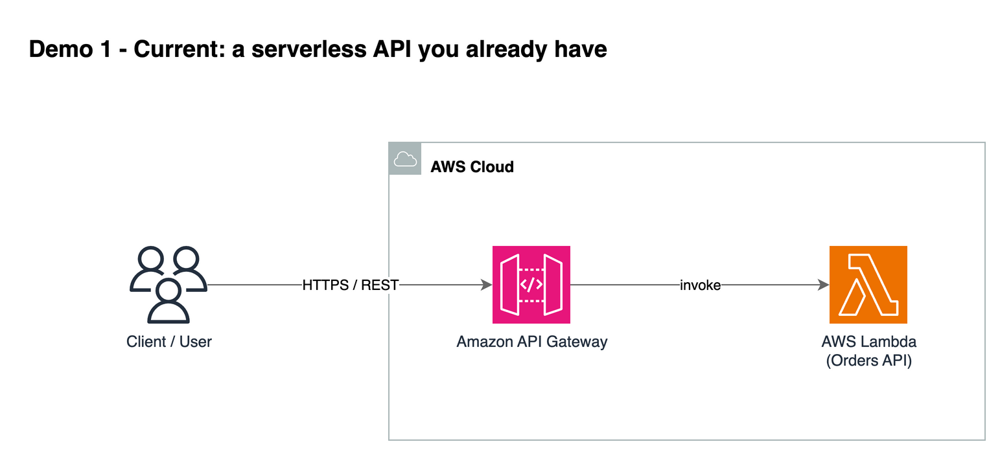
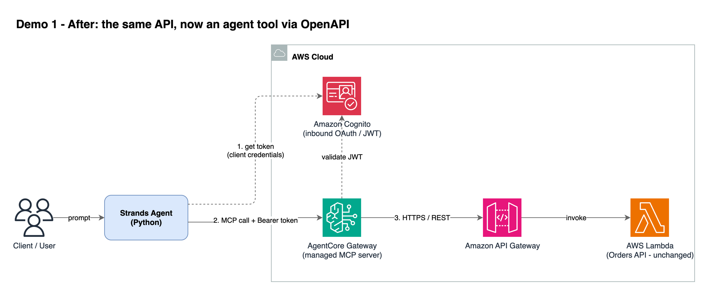

# Demo 1 — Serverless API → MCP Tool via OpenAPI

Take an existing **API Gateway → Lambda** Orders API and turn it into an MCP tool
an agent can call — provisioned with the **AgentCore CLI**. We stand the gateway
up with **JWT inbound auth from the start** (changing a gateway's authorizer after
the fact isn't supported); per-tool policies come in Demo 3.

## Architecture

### Before — a serverless API you already have


Client → **Amazon API Gateway** → **AWS Lambda** (Orders). We don't change a line of it.

### After — the same API, now an agent tool


**AgentCore Gateway** (a managed MCP server) fronts it. Each OpenAPI operation
becomes an MCP tool; a local Strands agent authenticates with a Cognito JWT,
discovers the tools, and calls them.

> OpenAPI target (not the `api-gateway` type) on purpose — to show it works
> against *any* OpenAPI HTTP service, not only API Gateway.

## Prerequisites

- Tools + AWS creds + the Python venv from [`../README.md`](../README.md) — which
  installs the AgentCore CLI, SAM CLI, jq, and `requirements.txt`
  (`strands-agents`, `mcp`, `boto3`).
- **[`../setup.sh`](../setup.sh) has been run once, from the repo root.** It
  deployed the "existing" Orders API + the shared Cognito pool (the
  `svs342-identity` stack in `demo-setup/identity/`), and wrote
  `demo.env` (the values this demo needs) plus
  `assets/specs/orders.generated.json` (the OpenAPI spec already pointed at your
  deployed `ApiBaseUrl`). You don't deploy any backend or edit any spec here — this
  demo only builds the AgentCore layer.

---

## Step A — Create the project + gateway

Start in a terminal **at the repo root** with the venv active
(`source .venv/bin/activate`).

**Load the setup values into your shell first — do this before any `agentcore`
command.** Besides the demo values (`DISCOVERY_URL`, `ALLOWED_CLIENTS`, …), this
exports `AWS_REGION`/`AWS_DEFAULT_REGION`, which is what pins the region the
`agentcore` CLI deploys the gateway into. Without it the gateway could land in a
different region than the Orders API and Cognito:

```bash
source demo.env
echo "$AWS_REGION"          # sanity check — should print us-west-2
```

Fetch the Orders API key. The API rejects calls without it, and you'll hand it
to the gateway as an outbound credential below. `setup.sh` only stored the key's
ID in `demo.env`; the value stays in this shell and is never written to disk:

```bash
export ORDERS_API_KEY=$(aws apigateway get-api-key --api-key "$ORDERS_API_KEY_ID" \
  --include-value --query value --output text)
```

Optional: confirm the existing Orders API works on its own — a plain HTTP call,
nothing agent-specific. Without the key you get a 403; with it, the order:

```bash
curl -s -o /dev/null -w "HTTP %{http_code}\n" "$API_BASE_URL/orders/12345"   # 403
curl -s -H "x-api-key: $ORDERS_API_KEY" "$API_BASE_URL/orders/12345" | jq .
```

Create the CLI project (this generates `toollayer/` at the repo root) and move
into it — the rest of the demos run from inside `toollayer/`:

```bash
agentcore create --name toollayer
cd toollayer
```

Add the gateway with JWT auth. `DISCOVERY_URL` (where the gateway finds the
pool's signing keys) and `ALLOWED_CLIENTS` (the customer + representative app
client IDs it accepts) are identity-stack outputs that `setup.sh` wrote into
`demo.env`, so there's nothing to paste. The CLI takes them as one JSON
authorizer configuration, which `jq` builds from the two values:

```bash
JWT_AUTHORIZER=$(jq -nc --arg url "$DISCOVERY_URL" --arg clients "$ALLOWED_CLIENTS" \
  '{customJwtAuthorizer: {discoveryUrl: $url, allowedClients: ($clients | split(","))}}')

agentcore add gateway --name demo-gateway --protocol-type MCP \
  --authorizer-type CUSTOM_JWT \
  --authorizer-configuration "$JWT_AUTHORIZER"
```

Add the API key as an outbound credential. Gateway sends it to the Orders API in
the `x-api-key` header on every tool call:

> **API keys are for throttling, not authorization.** The key lets a usage plan
> meter and throttle the caller; it doesn't prove who is calling. It's enough
> for this demo's fictional data. For a real API, use IAM (SigV4) or OAuth
> outbound auth instead. See [Security](../README.md#security).

The CLI doesn't accept the key as a command-line value (that would leave it in
your shell history), so pipe it in:

```bash
printf '%s' "$ORDERS_API_KEY" | agentcore add credentials api-key --name ordersKey --api-key -
```

Point the gateway at the generated OpenAPI spec — each operation becomes an MCP
tool. `setup.sh` already templated your `ApiBaseUrl` into
`orders.generated.json`. The target itself is described in
[`assets/targets/orders.json`](../assets/targets/orders.json): an `openApiSchema`
target named `orders` that reads that spec and sends the `ordersKey` credential:

```bash
agentcore add gateway-target --gateway demo-gateway \
  --target-configuration file://../assets/targets/orders.json
```

Deploy (renders + applies CDK; first gateway deploy ~2 min):

```bash
agentcore deploy
```

Capture the gateway URL into the environment (used by the web console below, and
in Demos 2 & 3). `agentcore status` reports the gateway's ARN; the gateway ID is
the last part of the ARN, and `agentcore gateway get` returns the URL for it:
```bash
export GATEWAY_ARN=$(agentcore status --json 2>/dev/null | jq -r '.resources[] | select(.resourceType == "gateway") | .arn')
export GATEWAY_URL=$(agentcore gateway get --id "${GATEWAY_ARN##*/}" --json 2>/dev/null | jq -r .gatewayUrl)
echo "$GATEWAY_URL"         # sanity check — should print an https:// URL
```
Also save it to `demo.env` (at the repo root, so the web console in Step B finds
it, and so a fresh terminal in Demos 2 & 3 inherits it). This replaces any
earlier `GATEWAY_URL` line:
```bash
grep -v "^export GATEWAY_URL=" ../demo.env > ../demo.env.tmp 2>/dev/null; mv ../demo.env.tmp ../demo.env
echo "export GATEWAY_URL=\"$GATEWAY_URL\"" >> ../demo.env
```
---
## Step B — Chat with the gateway in the web console
The console is a local web chat that talks to your gateway. It keeps a separate
agent session for each role, using a Cognito JWT it mints for that role.
Open a **second terminal at the repo root** (leave the `toollayer/` terminal
as it is) with the venv active and the setup values loaded, then start it:
```bash
source .venv/bin/activate
source demo.env
python assets/console/console.py
```
It serves **http://localhost:8001** (set `CONSOLE_PORT` to use another port) and
opens it in your browser. It listens on `127.0.0.1` only, has no login, and acts
with your local AWS credentials.
The console reads `GATEWAY_URL` from `demo.env` each time you click
**Reconnect**. If you started it before the gateway existed, it runs as a plain
model chat with no tools (it says so above the chat). Click **Reconnect** once
the URL is saved and it switches to the gateway.
In the page:
- Click **Show tools**. You should see the order tools
  (`orders___listOrders`, `orders___getOrder`).
- Ask **"What's the status of order 24680?"**. Replies stream in, and a chip
  marks each tool the agent calls.
- Click **Reconnect** after you deploy new tools (Demo 2) or change policies
  (Demo 3) so the chat picks them up.
Keep the console running and leave the `toollayer/` terminal open for Demo 2 and
Demo 3.

---

## Notes

- Tool names: `orders___getOrder` / `orders___listOrders` (target prefix + `___`).
- Reusable assets (specs, target definitions, policies, token minter, agent) live in `assets/`,
  referenced by `../assets/…` from inside the `toollayer/` project.
- JWT is on from here, so the console always sends a Bearer token. Enforcing *which*
  identity can do *what* is Demo 3.
- Cognito tokens expire after about an hour. If the agent starts getting 401s,
  click **Reconnect** in the console.

Next: [Demo 2](../Demo2) adds the refund workflow as a Lambda target.
