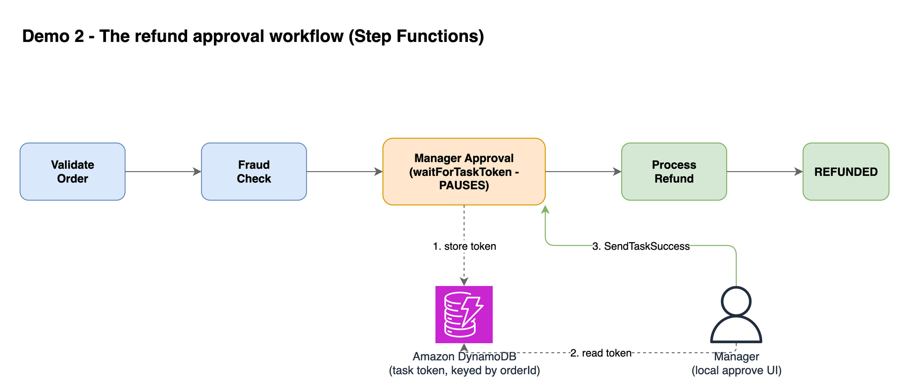
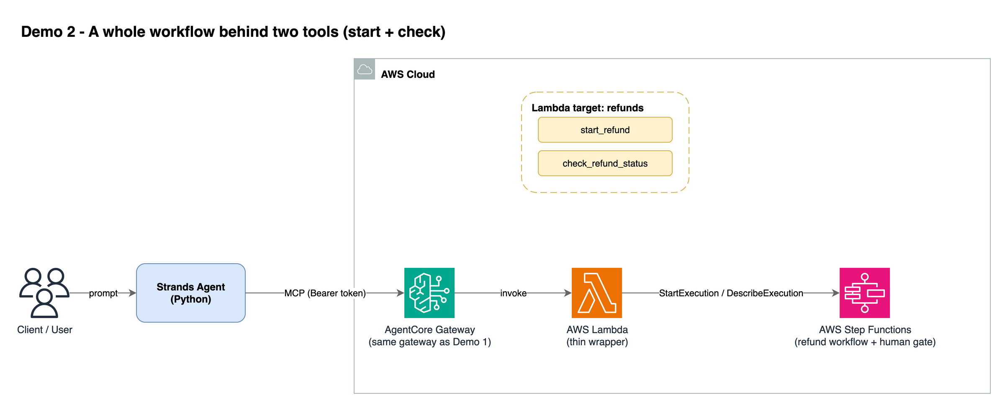

# Demo 2 — Wrapping a Step Functions Workflow as a Tool

Expose a refund-approval **Step Functions** workflow (with a human-in-the-loop
gate) as agent tools by adding a **Lambda target** to the same gateway from Demo 1.

**Aha:** a whole workflow behind two tools — added with one `agentcore add
gateway-target`. Lambda targets use the gateway IAM role (no outbound credential).

## Architecture

### The workflow (and its human gate)


### The same gateway, now with two more tools


A thin **Lambda** that calls `StartExecution` and reads the approvals table
becomes two MCP tools: `refunds___start_refund` and
`refunds___check_refund_status`.

## Prerequisites

- **Demo 1 completed** (`demo-gateway` exists, JWT auth on).
- **[`../setup.sh`](../setup.sh) has been run** — it already deployed the refund
  workflow backend (Standard state machine + DynamoDB + the thin Lambda), and the
  Lambda ARN is in `demo.env` as `REFUND_LAMBDA_ARN`. Nothing to deploy here.

---

## Step A — Add the Lambda as a gateway target

Continue in the Demo 1 terminal, inside `toollayer/` — `demo.env` and
`GATEWAY_URL` are already loaded there.

> **Fresh terminal?** Start at the repo root and restore the environment first
> (`demo.env` pins `AWS_REGION` for the `agentcore` CLI and provides
> `REFUND_LAMBDA_ARN`):
>
> ```bash
> source .venv/bin/activate
> source demo.env
> cd toollayer
> export GATEWAY_URL=$(agentcore status --type gateway --json 2>/dev/null | jq -r '.. | .gatewayUrl? // empty' | head -1)
> ```

Add the Lambda as a target — its tool schema (in `assets/`) describes the two
tools, since a Lambda has no OpenAPI spec:

```bash
agentcore add gateway-target --type lambda-function-arn --name refunds \
  --lambda-arn "$REFUND_LAMBDA_ARN" \
  --tool-schema-file ../assets/specs/refund_tools.json --gateway demo-gateway
```

Deploy:

```bash
agentcore deploy -y
```

---

## Step B — Run it through the human gate

Switch to the web console from Demo 1 (http://localhost:8001). If it isn't
running, start it from the repo root with `source demo.env` loaded
(`python assets/console/console.py`).

1. Click **Reconnect** so the chat picks up the new target.
2. Click **Show tools**. You should now see `refunds___start_refund` and
   `refunds___check_refund_status` alongside the order tools.
3. Chat as the **Customer Service Representative** (the default), and type
   **"Process a refund for order 12345"**. The agent starts the workflow and
   reports `PENDING_APPROVAL`. The workflow is now parked at the manager-approval
   gate.

Approve it with the local approvals app. It's a separate app from the console, so
open **another terminal at the repo root** and leave the chat open on port 8001
(the approvals app uses your local AWS credentials and has no login):

```bash
source .venv/bin/activate
source demo.env
python Demo2/approve_ui.py
```

It opens **http://localhost:8000** and shows each refund workflow as a row of steps.
This one is paused at **Manager approval**, the human-in-the-loop step. Click
**Approve** on order 12345 (Ctrl-C the app when you're done).

Back in the console chat, ask **"Is that refund done yet?"**. `check_refund_status`
reads the order's status from the approvals table. Only the workflow sets it:
`PENDING_APPROVAL` when it parks, and `REFUNDED` in its last step once you
approve. After approving you'll see **`REFUNDED`**; if you ask the
instant you click, you may still catch `PENDING_APPROVAL`. An order with no
refund returns `NO_REFUND_FOUND`.

Keep the console running and the `toollayer/` terminal open for Demo 3.


---

## Notes

- `assets/specs/refund_tools.json` is an array of `{name, description, inputSchema}`
  (no nested `json` wrapper).
- Register the **`refund-tools` Lambda ARN**, not the state machine ARN — Step
  Functions isn't a Gateway target type (that's why the thin Lambda exists).
- Both tools take only the `orderId`; the workflow keeps each order's status in
  DynamoDB, so the agent never tracks an execution ARN.
- We use the `representative` token here; JWT is on but no per-tool policy yet, so any
  valid token can start a refund. Demo 3 changes that.

Next: [Demo 3](../Demo3) locks the refund tool down with a Cedar policy.
