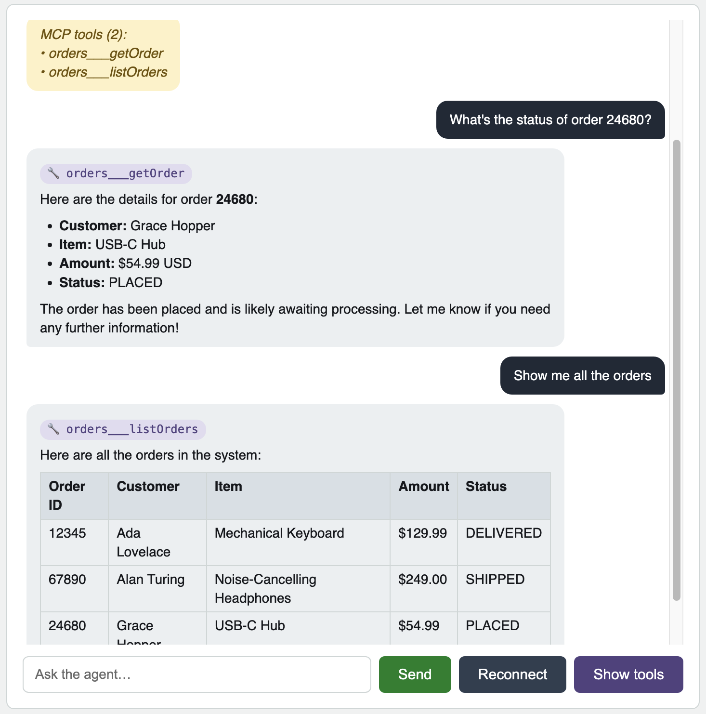
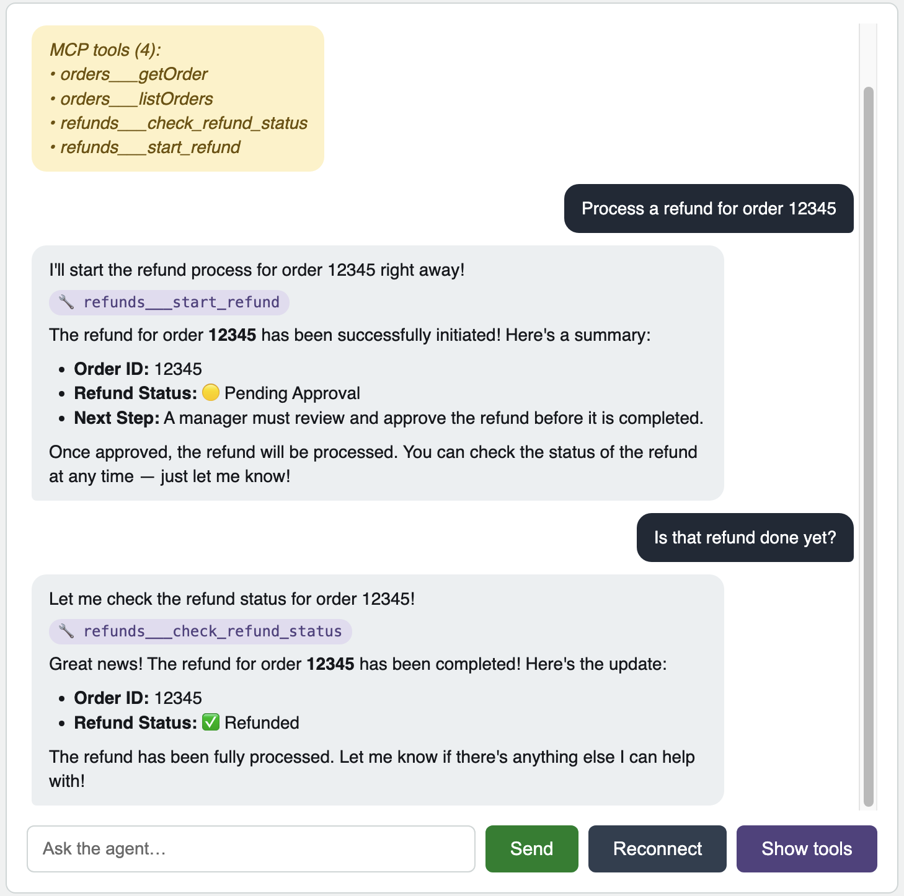

# Coding the Tool Layer for AI Agents on Serverless

Give an AI agent safe access to an API you already run, without rewriting the
API. This sample turns a plain API Gateway → Lambda service and a Step Functions
approval workflow into agent tools, and enforces who may call which tool at the
gateway instead of in the prompt.

<table>
<tr>
<td width="50%"></td>
<td width="50%"></td>
</tr>
<tr>
<td align="center"><sub><b>Demo 1:</b> the agent reads orders through the gateway.</sub></td>
<td align="center"><sub><b>Demo 2:</b> a refund starts, waits for a manager, then completes.</sub></td>
</tr>
</table>

## The problem, the solution, why it matters

**Terms used here.** **MCP** (Model Context Protocol) is an open protocol that
lets an AI agent discover and call tools over a standard interface. **Amazon
Bedrock AgentCore Gateway** is a managed service that serves your APIs and
Lambda functions as MCP tools. The **tool layer** is the part between the agent
and your backend that describes the tools, authenticates the caller, and decides
what that caller may do.

- **The problem.** You have a working API and want an agent to use it. The agent
  needs a tool description it can read, which your API does not provide as is. A
  human-approval workflow is not a single request and response. And "who is
  calling" cannot be left to the prompt, because a prompt is a request to the
  model, not an access control.
- **The solution.** Put AgentCore Gateway in front of what you already have. An
  OpenAPI spec or a tool schema becomes the description the agent reads. A thin
  Lambda starts the workflow and reports its status. A JWT identifies the caller,
  and a Cedar policy at the gateway decides which tools that caller can see and
  call.
- **Why it matters.** The backend is not rebuilt, you write no glue code per
  agent, and authorization is checked before the tool runs, so it holds even if
  the model is manipulated.

### Before and after: one refund request, two callers

A customer and a customer service representative both ask the same agent to
"Process a refund for order 12345."

| | Before (agent wired straight to the API) | After (agent calls the gateway) |
|---|---|---|
| Tool description | You hand-write one per agent | Generated from the OpenAPI spec or a tool schema in [`assets/specs/`](./assets/specs) |
| Approval workflow | No single call maps to "request a refund and wait for a manager" | A thin Lambda exposes `start_refund` and `check_refund_status`; the refund waits at a human approval step |
| Who may refund | Instructions in the prompt that a user can talk around | The customer's token lacks the `refund:create` scope, so the gateway never lists `start_refund` to that agent |
| Representative's agent | Same prompt, no enforcement | Sees `start_refund`, starts the workflow, and gets `PENDING_APPROVAL` until a person approves |
| Backend changes | Rewrite or wrap per agent | None to the Orders API or the workflow |

[Demo 3](./Demo3) runs exactly this: the same prompt with two tokens. With the
customer token the refund tool is not available. With the representative token
the refund starts and parks at the manager gate from [Demo 2](./Demo2), which you
approve with a local web app.

## Contents

- [The pattern](#the-pattern)
- [Getting started](#getting-started)
- [Repository layout](#repository-layout)
- [Supported Regions](#supported-regions)
- [Cost](#cost)
- [AWS services used](#aws-services-used)
- [The playbook](#the-playbook--turning-any-api-into-an-agent-tool)
- [Security](#security)
- [Known limitations](#known-limitations)
- [Troubleshooting](#troubleshooting)
- [What cleanup does not remove](#what-cleanup-does-not-remove)
- [Origin](#origin)
- [License](#license)

## The pattern

**Before.** The backends work, but the agent has no tool description to read and
no caller-based access control.


*Before: an existing serverless backend with nothing that makes it an agent tool.*

**Final.** The same backends sit behind AgentCore Gateway. Cognito issues a JWT
per identity, the gateway validates it, and a Cedar policy decides which tools
that caller may use.


*Final: the same backends behind AgentCore Gateway, with JWT inbound auth and a Cedar policy at the gateway.*

## Getting started

Install the prerequisites, deploy the sample backends with `./setup.sh`, work
through Demos 1 to 3, then run `./cleanup.sh`. The demos build the tool layer
with the [AgentCore CLI](https://github.com/aws/agentcore-cli)
(`@aws/agentcore`).

### 1. Install the prerequisites

Install these once.

| Tool | Why | Min version | Check |
|---|---|---|---|
| **Node.js** | Runs the AgentCore CLI | 20.x | `node --version` |
| **uv** | Manages Python environments/deps for agents | 0.4+ | `uv --version` |
| **AWS CLI** | Authenticates to AWS and verifies your setup | 2.x | `aws --version` |
| **Git** | Version control (used by `agentcore create`) | 2.x | `git --version` |
| **AgentCore CLI** | Provisions the gateway, targets, and policies | latest | `agentcore --version` |
| **AWS SAM CLI** | Deploys the demo backends | latest | `sam --version` |
| **jq** | Reads the gateway URL/ARN from `agentcore status --json` | 1.6+ | `jq --version` |
| **A web browser** | Shows the local web console you chat with in the demos | any current | none |

You also need:

- **AWS credentials** with permission for Lambda, API Gateway, Step Functions,
  DynamoDB, Amazon Bedrock AgentCore, Amazon Cognito, and IAM.
- **Amazon Bedrock model access** to **Claude Sonnet 4.6**
  (`us.anthropic.claude-sonnet-4-6`) in your Region. Enable it in the Bedrock
  console → Model catalog (one-time).
- A Region where **AgentCore Gateway** (and **Policy in AgentCore**, for Demo 3)
  is available. Examples use **`us-west-2`**. See [Supported Regions](#supported-regions).

#### Install the tools

```bash
# Node.js (macOS/Linux via nvm; Windows: nodejs.org or nvm-windows)
nvm install 20 && nvm use 20

# uv (macOS/Linux; Windows: powershell -c "irm https://astral.sh/uv/install.ps1 | iex")
curl -LsSf https://astral.sh/uv/install.sh | sh

# AgentCore CLI
npm install -g @aws/agentcore@latest

# AWS CLI v2 and SAM CLI: follow the official installers, then:
aws configure          # set credentials + region (examples use us-west-2)
```

- AWS CLI v2: [official guide](https://docs.aws.amazon.com/cli/latest/userguide/getting-started-install.html)
- AWS SAM CLI: [installation guide](https://docs.aws.amazon.com/serverless-application-model/latest/developerguide/install-sam-cli.html)
- Git: [git-scm.com/downloads](https://git-scm.com/downloads)

#### Python env for the web console and token minting (once)

The web console, the terminal agent and the token minter aren't part of the CLI. They
run locally by choice, and `mint_token.py` uses boto3 to read the Cognito client
it needs. Set up one virtual environment at the repo root for all three demos:

```bash
uv venv && source .venv/bin/activate     # do this in each new terminal
uv pip install -r requirements.txt
```

`requirements.txt` pins exact tested versions of `strands-agents` + `mcp` (the
web console and the terminal `agent.py` fallback) and `boto3` (`mint_token.py` +
the Demo 2 approval app). The SAM Lambda backends
need no requirements file — they're stdlib-only or use the Lambda runtime's
built-in `boto3`. `deactivate` to exit; `.venv/` is gitignored.

### 2. Deploy the sample backends

Run [`./setup.sh`](./setup.sh) from the repo root, once. It deploys the
*pre-existing* infrastructure as three SAM stacks under
[`demo-setup/`](./demo-setup): the Orders API, the refund workflow, and the
shared Cognito identity pool. It is safe to re-run (CloudFormation updates each
stack in place). It writes a gitignored `demo.env` (the values the demos read via
`source demo.env`) and `assets/specs/orders.generated.json` (the OpenAPI spec
already pointed at your deployed `ApiBaseUrl`).

### 3. Build the tool layer

| # | Folder | What it shows |
|---|--------|---------------|
| 1 | [`Demo1/`](./Demo1) | Expose a serverless API as an MCP tool via its **OpenAPI spec** (OpenAPI target) |
| 2 | [`Demo2/`](./Demo2) | Wrap a **Step Functions** workflow (human-in-the-loop) as callable tools (Lambda target) |
| 3 | [`Demo3/`](./Demo3) | **Scoped agent identity** — block an unauthorized call, allow an authorized one (JWT + Cedar policy) |

Each demo has its own README with diagrams and the commands in order, and
explains what each one does. **Run them in order.** Demo 1 creates the AgentCore
Gateway. Demos 2 and 3 attach to that same gateway, and Demo 3 also gates Demo 2's
refund tool. In the demos you chat with your gateway in a local web console
(`python assets/console/console.py`, then open http://localhost:8001). It has a
Reconnect button for picking up new tools after each deploy, a Show tools button
that lists what the active role can see, and, once Demo 3 is under way, a switch
between the customer and the customer service representative. Each demo README says
when to use them. The command-line agent (`assets/agent/agent.py`) still works as a
fallback.

You **create the `toollayer/` project yourself** with `agentcore create` (Demo 1) and
point the `agentcore add` commands at the pre-made assets in [`assets/`](./assets)
(`../assets/…` from inside `toollayer/`). `toollayer/` is gitignored: it is
generated, not committed.

### 4. Clean up

Run `./cleanup.sh` when you're done. It tears down the AgentCore
gateway/targets/policies, all three SAM stacks (Cognito included), and the
generated artifacts. See [What cleanup does not remove](#what-cleanup-does-not-remove).

## Repository layout

```
.
├── setup.sh                 # deploys the three pre-existing stacks; writes demo.env
├── cleanup.sh               # single teardown for everything setup.sh + the demos create
├── demo.env                 # generated by setup.sh (gitignored) — source it before demos
├── demo-setup/              # the "pre-existing" infra (three SAM stacks, deployed by setup.sh)
│   ├── orders-api/          # Demo 1's API Gateway -> Lambda Orders API
│   ├── refund-workflow/     # Demo 2's Step Functions workflow + thin Lambda
│   └── identity/            # shared Cognito pool: customer + representative clients
├── Demo1/  Demo2/  Demo3/   # step-by-step walkthroughs with diagrams (no backends)
│                            #   Demo2/ also has approve_ui.py (approvals app, port 8000)
├── assets/                  # reusable assets, referenced from the toollayer/ project
│   ├── specs/               # orders.yaml, refund_tools.json (target schemas)
│   │                        #   orders.generated.json is generated by setup.sh (gitignored)
│   ├── policies/            # permit_read.cedar, permit_start_refund.cedar
│   ├── identity/            # mint_token.py — mints a Cognito JWT for one identity
│   ├── console/console.py   # local web chat for the gateway (http://localhost:8001)
│   └── agent/agent.py       # local Strands client (command-line fallback)
├── requirements.txt         # web console, agent and token minting (strands-agents, mcp, boto3)
└── toollayer/               # created in Demo 1 by `agentcore create` (NOT committed)
    └── agentcore/… cdk/…    # declarative config + the CDK the CLI deploys
```

## Supported Regions

- **Examples use `us-west-2`.** `setup.sh` and `cleanup.sh` default to it, and
  `setup.sh` writes it into `demo.env`. To use another Region, export
  `AWS_REGION` before running `./setup.sh`, and `source demo.env` before any
  `agentcore` command (the CLI otherwise falls back to `us-east-1`).
- **Services the Region must offer:** Amazon Bedrock AgentCore Gateway and
  Policy in AgentCore (Demo 3), plus API Gateway, Lambda, Step Functions,
  DynamoDB, Cognito, and Bedrock. Check the AWS Regional services list for
  current availability. Only `us-west-2` has been exercised by the author.
- **The Bedrock model id uses a `us.` prefix.**
  [`assets/agent/agent.py`](./assets/agent/agent.py) sets
  `MODEL_ID = "us.anthropic.claude-sonnet-4-6"`. The `us.` prefix names a US
  cross-Region inference profile, so the model must be enabled in your account
  for a Region that profile covers. For a Region outside that set, change
  `MODEL_ID` in `assets/console/console.py`, `agent.py` (and `agent-no-mcp.py`) to an inference profile
  or model id available there.

## Cost

You are responsible for the charges these resources incur. This sample creates
real AWS resources, so don't leave them running. **Run `./cleanup.sh` as soon as
you finish.** Consider setting an
[AWS Budgets](https://aws.amazon.com/aws-cost-management/aws-budgets/) alert
before you start.

### Estimate

**About $2.40 for one person working through all three demos in a day, in
`us-west-2`.** This is an estimate from published list prices (checked November
2026) and the usage assumptions below. It is not a measured bill. Prices change,
so use the [AWS Pricing Calculator](https://calculator.aws/) to estimate your own
workload.

Assumptions: 60 chat turns across the three demos, about 2 model calls per turn
(4,000 input and 300 output tokens each), 120 gateway tool calls (90 of them tool
invocations), 100 API requests, 10 refund workflows, and 100 Cognito token
requests.

**Pre-existing infrastructure** (deployed by `./setup.sh`, the stand-in for the
backend you already run):

| Service | What bills | Estimated cost |
|---|---|---|
| Amazon Cognito | 100 machine-to-machine token requests at $2.25 per 1,000 | $0.23 |
| Amazon API Gateway | 100 REST API requests at $3.50 per million | less than $0.01 |
| AWS Step Functions | About 50 state transitions, inside the 4,000 free per month | $0.00 |
| AWS Lambda, Amazon DynamoDB, Amazon CloudWatch Logs, S3 (SAM bucket) | A few hundred invocations, a handful of items, a few KB of logs | less than $0.01 each |
| **Subtotal** | | **about $0.23** |

**New parts added in the demos** (the agent tool layer you build):

| Service | What bills | Estimated cost |
|---|---|---|
| Amazon Bedrock (Claude Sonnet 4.6) | 0.48M input and 0.036M output tokens at $3.30 and $16.50 per million (the `us.` inference profile) | $2.18 |
| Amazon Bedrock AgentCore Gateway | 120 calls at $5 per million | less than $0.01 |
| Policy in AgentCore | 120 authorization requests at $25 per million | less than $0.01 |
| **Subtotal** | | **about $2.18** |

**Total: about $2.40.**

Model tokens are about 90% of the cost, so the number scales with how much you
chat. Ten times the usage is about $25. The other services are priced per request
or per token and are close to zero at this volume. Nothing in the templates here
is billed by the hour, but check your own bill, because the SAM deploy bucket
and any leftover resources are listed under
[What cleanup does not remove](#what-cleanup-does-not-remove).

## AWS services used

| Service | Role in this sample |
|---|---|
| Amazon Bedrock AgentCore Gateway | Managed MCP server that exposes the API and the Lambda as tools |
| Policy in AgentCore (Cedar) | Per-tool allow rules evaluated at the gateway |
| Amazon API Gateway | The existing Orders REST API, with an API key and usage plan |
| AWS Lambda | Orders backend (`orders-api`) and the thin `refund-tools` wrapper |
| AWS Step Functions | Standard workflow that waits for a manager's approval |
| Amazon DynamoDB | `refund-approvals` table holding each order's refund status |
| Amazon Cognito | User pool, `refunds` resource server, and the `customer` and `representative` app clients that issue JWTs |
| AWS IAM | Execution roles for the Lambdas, the workflow, and the gateway |
| Amazon Bedrock | Claude Sonnet 4.6 model used by the local agent |
| AWS CloudFormation / AWS SAM | Deploys the three backend stacks in [`demo-setup/`](./demo-setup) |

Local tooling: the AgentCore CLI (provisions the gateway, targets and policies
by rendering and deploying CDK), the Strands Agents SDK (the agent in
`console.py` and `agent.py`), and Python for all demo code.

## The playbook — turning any API into an agent tool

The repeatable pattern behind the three demos. Given something you want an agent
to use, pick the target type, then decide whether to add per-tool identity:

```
What are you exposing?
├─ A REST API with an OpenAPI spec ........ OpenAPI target      (Demo 1)
│     hand Gateway the spec; every operation becomes a tool. No server code.
├─ A single Lambda function ............... Lambda target       (Demo 2)
│     supply a tool schema (name + input schema); Gateway invokes the Lambda.
└─ Something that ISN'T a Gateway target
   (Step Functions, a multi-step or
   human-in-the-loop workflow) ............ wrap it in a thin Lambda, then
                                            register THAT as a Lambda target (Demo 2)
                                            long-running? split into start + check tools.

Then: does this tool need per-caller control?
└─ Yes → attach a Cedar policy at the Gateway boundary and gate the tool by a
         JWT scope (Policy in AgentCore). Enforced before the tool runs — not
         left to the prompt.                                     (Demo 3)
```

Inbound OAuth (Cognito JWT) controls **who reaches the gateway**; a Cedar policy
controls **which tools each identity may call**.

## Security

The Cognito app client secrets never leave Cognito: they aren't stack outputs,
and `assets/identity/mint_token.py` fetches the secret at runtime
(`describe_user_pool_client`) for each token it mints. Nothing secret is written
to disk.

### Demo-only shortcuts (not for production)

These stacks are sized for a learning sandbox account and are meant to be
torn down with `./cleanup.sh` afterward. The related scanner findings are
suppressed in the templates with these reasons:

- **API keys are for throttling, not authorization.** An API Gateway API key
  identifies a caller so a usage plan can meter and throttle it. It is a shared,
  long-lived value that doesn't prove who is calling or what they're allowed to
  do, so **don't copy this pattern to protect a real API**. Here, every Orders
  API route requires the `x-api-key` header, and a usage plan throttles callers
  (10 req/s, burst 20, 10,000/day); that keeps a demo endpoint with fictional
  data from being called anonymously, nothing more. Demo 1 registers the key as
  the gateway target's outbound credential; the key value is fetched at runtime
  and never written to disk. The OpenAPI specs don't declare the key because
  AgentCore Gateway doesn't support spec-level security schemes. For production,
  authorize the gateway's calls to your API with IAM (SigV4) or OAuth outbound
  auth, and keep API keys (if you use them at all) for usage plans.
- **The local apps have no login.** The web console (`assets/console/console.py`) and the
  approvals app (`Demo2/approve_ui.py`) listen on `127.0.0.1` only, refuse requests from other
  websites, and act with your local AWS credentials (the approvals app also reads Step Functions
  execution history). A real approval step needs an authenticated,
  audited UI.
- **No API Gateway access logs.** Access logging needs an account-level API
  Gateway CloudWatch role, which fresh accounts often don't have.
- **No reserved concurrency on the Lambdas.** Reserving concurrency fails to
  deploy in accounts with the default low concurrency limit.
- **Lambdas run outside a VPC and have no DLQ.** They don't access any VPC
  resources, and they're only invoked synchronously, so a DLQ would never
  receive anything.

- **Cognito client-credentials apps stand in for users.** The `customer` and
  `representative` identities are machine app clients
  (`AllowedOAuthFlows: [client_credentials]` in
  [`demo-setup/identity/template.yaml`](./demo-setup/identity/template.yaml)),
  each with a secret that anyone with Cognito read access to your account can
  fetch. A real deployment would authenticate people (for example the
  authorization-code flow or a corporate identity provider) and map them to scopes.
- **The Cedar scope check is a substring match.**
  [`assets/policies/permit_start_refund.cedar`](./assets/policies/permit_start_refund.cedar)
  tests `principal.getTag("scope") like "*refund:create*"`. Any scope string that
  contains `refund:create` would pass, not only `refunds/refund:create`. This is
  fine with the two scopes defined here. If you add scopes, check for overlap or
  match the whole scope more strictly.
- **Token lifetime is the Cognito default.** The identity template sets no
  token validity, so access tokens use Cognito's default. The Demo 1 notes say
  about one hour (not independently measured here). A leaked token works until
  it expires, and the policy has no revocation step.

See [CONTRIBUTING](CONTRIBUTING.md#security-issue-notifications) for more information.

## Known limitations

- Single account and Region, one gateway, fictional order data.
- The identities are machine clients, not people (see [Security](#security)).
- The refund workflow waits at most 3600 seconds (`TimeoutSeconds` in
  [`demo-setup/refund-workflow/statemachine/refund.asl.json`](./demo-setup/refund-workflow/statemachine/refund.asl.json))
  for approval, then the execution times out.
- The web console and the approvals app are local-only and have no login.
- The Cedar policy gates `start_refund` only. Approving a refund is a separate,
  human step.
- `setup.sh` needs the Python venv active (it imports PyYAML) and uses fixed
  resource names, so it supports one copy per account and Region.
- Region coverage beyond `us-west-2` is untested (see [Supported Regions](#supported-regions)).

## Troubleshooting

| Symptom | Cause and fix |
|---|---|
| The chat fails with Bedrock `AccessDeniedException` | Model access for Claude Sonnet 4.6 isn't enabled in your Region, or your credentials lack Bedrock permissions. Enable it in the Bedrock console → Model catalog. |
| The chat gets `401` from the gateway | The Cognito token expired (about an hour, per the Demo 1 notes). Click **Reconnect** in the web console. For the terminal agent, mint a new one: `export GATEWAY_TOKEN=$(python ../assets/identity/mint_token.py representative)`. |
| The console shows "Model only" or "No gateway is configured" | `GATEWAY_URL` isn't in `demo.env` yet, or points at a gateway that no longer exists. Save the current URL with the command at the end of Demo 1 Step A, then click **Reconnect**. |
| The console or approvals app fails with "address already in use" | Another process has port 8001 (console) or 8000 (approvals). Stop it, or set `CONSOLE_PORT` / `APPROVE_PORT` to a free port. |
| Gateway lands in the wrong Region, or the CLI can't find stacks | `agentcore` defaults to `us-east-1` without `AWS_REGION`. Run `source demo.env` in every new terminal before `agentcore` commands. |
| `setup.sh` prints `PyYAML not found` | The venv isn't active. Run `source .venv/bin/activate && uv pip install -r requirements.txt`. |
| Refund stays `PENDING_APPROVAL` | It is waiting for approval. Run `python Demo2/approve_ui.py` from the repo root and click **Approve** at http://localhost:8000. After 3600 seconds the workflow execution times out. |
| The approvals app shows "State machine refund-approval not found" or `AccessDenied` | The app looks for the `refund-approval` state machine in `AWS_REGION` (or `STATE_MACHINE_ARN`). Run `source demo.env` and confirm `setup.sh` finished. Your credentials also need `states:ListExecutions`, `states:DescribeExecution` and `states:GetExecutionHistory`. |
| The customer role doesn't list `start_refund` | Expected. That identity lacks the `refund:create` scope (Demo 3). |
| `setup.sh` fails on an existing resource | Names are fixed (stacks `svs342-*`, Lambdas `orders-api` and `refund-tools`, table `refund-approvals`), so a leftover copy or an unrelated resource with the same name collides. Run `./cleanup.sh` or rename the resource. |

## What cleanup does not remove

`./cleanup.sh` removes the gateway, targets, credential, policies, the three SAM
stacks, the `orders-api` and `refund-tools` Lambda log groups, `demo.env`,
`assets/specs/orders.generated.json`, generated policy copies, and `toollayer/`.
From reading `setup.sh` and `cleanup.sh`, it does **not** remove:

- **Your local `.venv/`** and installed CLIs. Delete `.venv/` yourself if you want it gone.
- **The SAM-managed artifact bucket.** `setup.sh` deploys with `--resolve-s3`,
  which uses a bucket SAM creates once per account and Region, and `cleanup.sh`
  doesn't delete that bucket or its stack. Check your account for it.

## Origin

Originally built for the AWS re:Invent 2026 session SVS342.

## License

This project is licensed under the Apache-2.0 License. See the [LICENSE](LICENSE) file.
